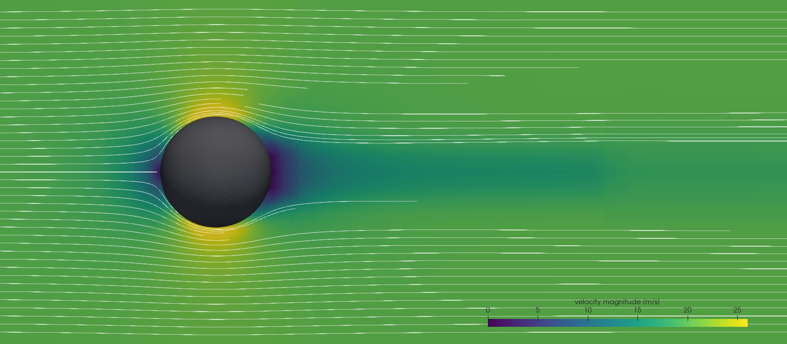
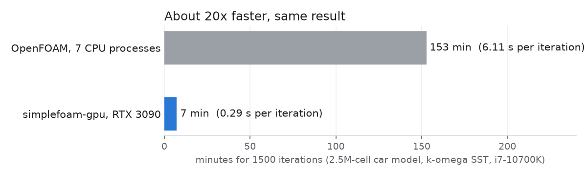
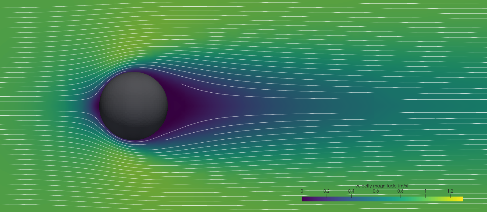

# simplefoam-gpu

A GPU solver for OpenFOAM `simpleFoam` cases. It reads an ordinary OpenFOAM case folder, solves the steady
incompressible flow entirely on an NVIDIA GPU, and writes OpenFOAM-format results that match `simpleFoam` to
7–8 digits, about **20x faster** than OpenFOAM on the CPU.



*Flow around a sphere at Re = 1.4 million (k-omega SST with wall functions), solved with simplefoam-gpu.
Drag coefficient 0.0837256065; OpenFOAM gives 0.0837256068 on the same mesh.*

It is not a new CFD method. It reproduces OpenFOAM's own discretisation term by term (the same schemes, boundary
conditions, relaxation, SIMPLEC algorithm, k-omega SST model and wall functions), so you get OpenFOAM's answer,
only faster. Every part of the iteration runs on the GPU in double precision.



## Results

**Same answer as OpenFOAM:**

| Check | simplefoam-gpu | OpenFOAM v2412 `simpleFoam` |
|---|---|---|
| Laminar sphere, Re 40 (53k cells), drag coefficient | 1.869929 | 1.869929 |
| Turbulent sphere, Re 1.4e6, k-omega SST, drag coefficient | 0.0837256065 | 0.0837256068 |
| Turbulent sphere, all 12 force and moment coefficients | | agree to 7–8 digits |
| Turbulent sphere, converged fields, largest difference in any cell | | U 4e-7, nut 1e-5 (relative) |
| Turbulent sphere, y+ min / max / average | 33.13 / 1591.95 / 699.32 | identical to 7–8 digits |
| 2.5M-cell car model, drag history restarted from the same state | | within 0.016% over 1,350 iterations |

A direct test: start OpenFOAM from simplefoam-gpu's converged laminar solution and run one iteration. OpenFOAM's
initial momentum residuals are 1.3e-15, 1.3e-15 and 6.9e-16 (x, y, z). In other words, the GPU solution is already
converged in OpenFOAM's own equations, to machine precision.

The OpenFOAM reference runs use the transpose fix described [below](#an-openfoam-bug-found-on-the-way). Without it,
OpenFOAM's x-momentum residual in that same test is 0.015.

**Speed** (Intel i7-10700K, NVIDIA RTX 3090):

| Case | OpenFOAM, CPU | simplefoam-gpu |
|---|---|---|
| 2.5M-cell car model, k-omega SST | 6.01 s per iteration (3 MPI processes)<br>6.11 s per iteration (7 MPI processes) | 0.29 s per iteration |
| Laminar sphere, 53k cells | | 0.018 s per iteration (3000 iterations in 54 s) |
| Turbulent sphere, 53k cells | | 0.030 s per iteration (3000 iterations in 91 s) |

More CPU cores don't help here: OpenFOAM is limited by memory bandwidth, and 7 processes run no faster than 3 on
this 8-core desktop CPU. The GPU has about 20x the memory bandwidth, which is where the speed-up comes from. Small
meshes don't fill a GPU, so the speed-up grows with mesh size.



*Laminar sphere at Re = 40: the steady recirculation behind the sphere, from the `sphere-laminar` example.*

## What it supports

- **Solver:** `simpleFoam` (steady, incompressible), SIMPLE or SIMPLEC (`consistent yes`), `nNonOrthogonalCorrectors`,
  field and equation relaxation
- **Turbulence:** laminar, or RAS `kOmegaSST` as in OpenFOAM v2412 (F3 off, no decay control)
- **Schemes** (these exact ones; other schemes are refused):
  - `div(phi,U)` `bounded Gauss linearUpwindV grad(U)`; `grad(U)` `cellLimited Gauss linear 1`
  - `div(phi,k)`, `div(phi,omega)` `bounded Gauss upwind`; other gradients `Gauss linear`
  - laplacians `Gauss linear corrected`; `div((nuEff*dev2(T(grad(U)))))` `Gauss linear`
- **Boundary conditions:**
  - U: `fixedValue`, `noSlip`, `slip`, `symmetry`, `zeroGradient`, `pressureInletOutletVelocity`, `inletOutlet`
  - p: `fixedValue`, `zeroGradient`
  - k, omega: `fixedValue`, `inletOutlet`, `zeroGradient`, `kqRWallFunction`, `omegaWallFunction`
  - nut: `calculated`, `nutUSpaldingWallFunction`
- **Patch types:** `patch`, `wall`, `symmetry`, `symmetryPlane`
- **Output:** time folders (`U p phi`, plus `k omega nut yPlus` for k-omega SST), `forceCoeffs` (all 12 columns),
  y+ on walls. It follows `controlDict`: `startFrom`, `endTime`, `writeInterval`, `purgeWrite`, and
  `stopAt writeNow` edited during a run.

**Not supported:** other solvers (`rhoSimpleFoam`, `pimpleFoam` and so on), MRF, fvOptions, other turbulence models,
`empty`, `cyclic` and processor patches, and running across several GPUs. Before solving, it checks the case and
stops with a list of anything it doesn't implement, instead of quietly solving a different problem.

## Requirements

- An NVIDIA GPU with CUDA 11 or 12, and enough GPU memory: about 5 GB per million cells for k-omega SST
- Python 3.10 or newer, with [CuPy](https://cupy.dev), NumPy and SciPy
- OpenFOAM (developed against v2412) to make the mesh and the starting fields. The solving itself doesn't use OpenFOAM.

## Install

```bash
git clone https://github.com/skipper-hack/simplefoam-gpu.git
cd simplefoam-gpu
pip install -e ".[cuda12]"     # or ".[cuda11]"; or install cupy from conda-forge and run: pip install -e .
```

## Quick start

The examples are a sphere in a box, meshed with `blockMesh` and `snappyHexMesh`:

```bash
cd examples/sphere-kOmegaSST
./Allrun            # meshes with OpenFOAM, then solves on the GPU
```

`Allrun` runs `Allmesh` (blockMesh, snappyHexMesh, potentialFoam, and the wall distance via
`checkMesh -writeFields '(wallDistance)'`), then `simplefoam-gpu`. `Allrun-openfoam` solves the same case with
OpenFOAM's `simpleFoam` for comparison, and `Allclean` removes the results.

## Use on your own case

Set the case up as you would for `simpleFoam` (supported settings above), then, inside the case folder:

```bash
potentialFoam -initialiseUBCs                  # optional: a better starting field
checkMesh -writeFields '(wallDistance)'        # optional: OpenFOAM's wall distance (k-omega SST)
simplefoam-gpu .
```

Options:

| Option | Meaning |
|---|---|
| `--start TIME` | start time, or `latestTime` (default: from `controlDict`) |
| `--iters N` | number of iterations (default: up to `endTime`) |
| `--every N` | print progress every N iterations (default 10) |
| `--no-output` | don't write time folders or postProcessing files |

The results open in ParaView like any OpenFOAM case. Without a `wallDistance` field, the solver computes the wall
distance on the GPU. Next to walls it is exact; elsewhere it uses a mesh-wave method like OpenFOAM's.

Environment variables: `SIMPLEFOAM_GPU_PROFILE=1` prints the time spent in each stage;
`SIMPLEFOAM_GPU_REFERENCE=1` replaces the fused CUDA kernels with plain array code, for checking the kernels.

`python -m simplefoam_gpu.compare <caseA> <timeA> <caseB> <timeB>` compares two solutions cell by cell.

## How it works

- **Mesh geometry:** face areas, cell centres, volumes and interpolation weights are computed the way OpenFOAM's
  `primitiveMesh` does (identical to 1e-14).
- **Momentum:** the momentum matrix is assembled on the GPU. Custom CUDA kernels compute the limited velocity
  gradient and the explicit face fluxes (linearUpwindV correction, non-orthogonal correction, viscous stress) in
  one pass over the faces.
- **Pressure:** the pressure equation is solved with conjugate gradients preconditioned by aggregation multigrid.
  The coarse levels are built once and re-summed on the GPU every iteration.
- **Other equations:** U, k and omega use Jacobi-preconditioned BiCGStab. The linear solvers are not OpenFOAM's
  (GAMG, smoothSolver), but they converge to the same tolerances, so the converged answer is the same.
- **Exact reductions:** min/max reductions use exact 64-bit atomics, so limiters match OpenFOAM bit for bit.

## An OpenFOAM bug found on the way

While validating, we found that the conda-forge build of OpenFOAM v2412 (`openfoam-2412-h946d6a9_1`) transposes
tensor fields wrongly when the result and input are the same field: in every even-numbered cell, one component is
left untransposed. OpenFOAM does exactly that inside the viscous stress term `dev2(T(grad(U)))` of every
turbulence model, so the x-momentum equation of every `simpleFoam` and `rhoSimpleFoam` run with that build is
slightly wrong. A mirror-symmetric case gives an asymmetric answer, and on a car model the drag moved by 0.3%.

[`openfoam-fix/`](openfoam-fix/) has a tiny library that fixes it without rebuilding OpenFOAM, and a test program
that tells you whether your OpenFOAM build is affected. It is licensed GPL-3, like OpenFOAM.

## Tests

```bash
python -m unittest discover tests                            # kernels, file reading, case checks (seconds)
SIMPLEFOAM_GPU_SLOW=1 python -m unittest discover tests      # also full example runs (mesh them first)
```

## Images

The images above come from the examples: `pvbatch docs/render_examples.py examples/sphere-laminar
examples/sphere-kOmegaSST` (ParaView) and `python docs/speed_chart.py`.

## License

The solver is MIT licensed (see [LICENSE](LICENSE)). The OpenFOAM fix in `openfoam-fix/` is GPL-3, because it is
compiled against OpenFOAM. OpenFOAM is a registered trademark of OpenCFD Ltd; this project is not affiliated with
or endorsed by OpenCFD or the OpenFOAM Foundation.
